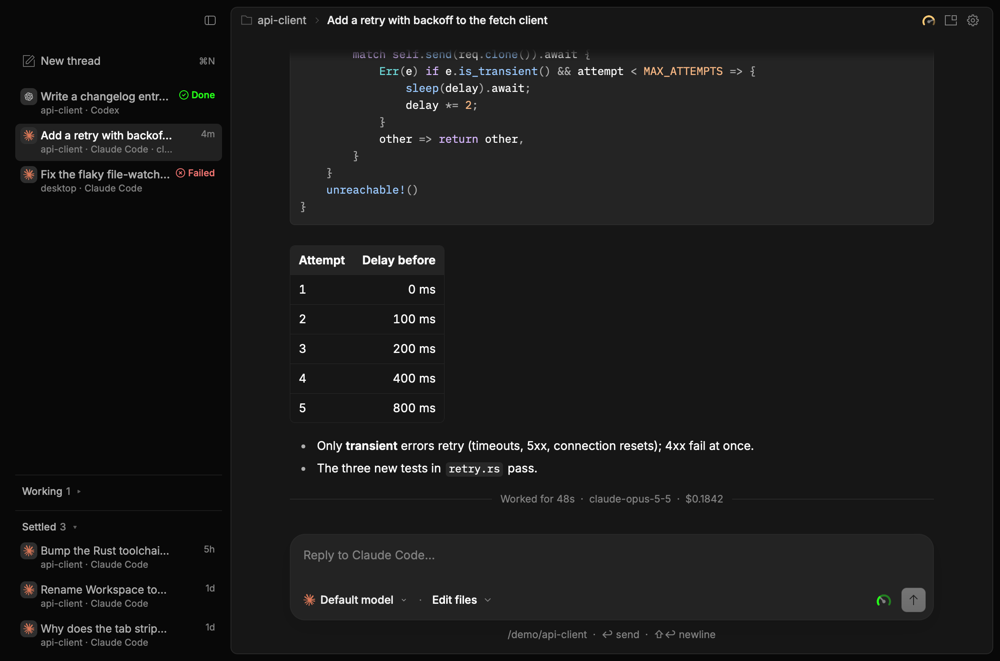
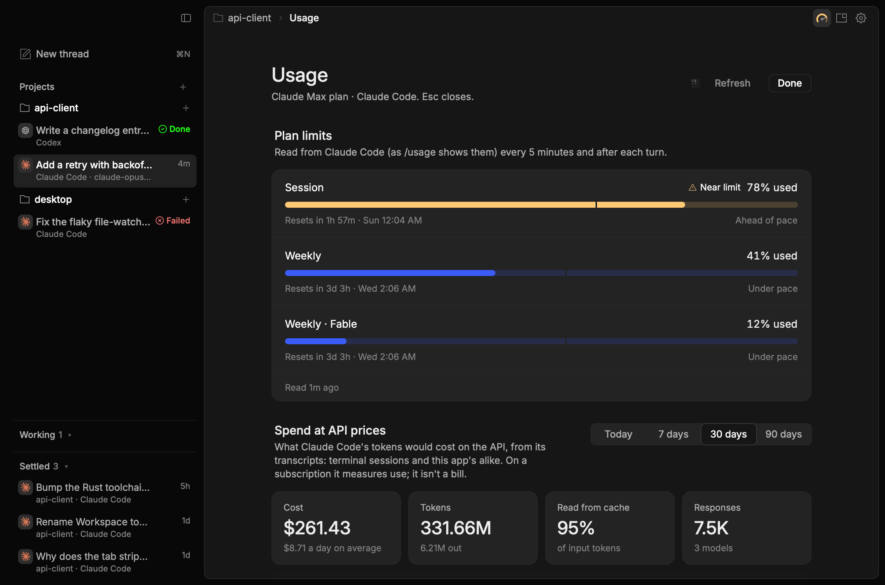
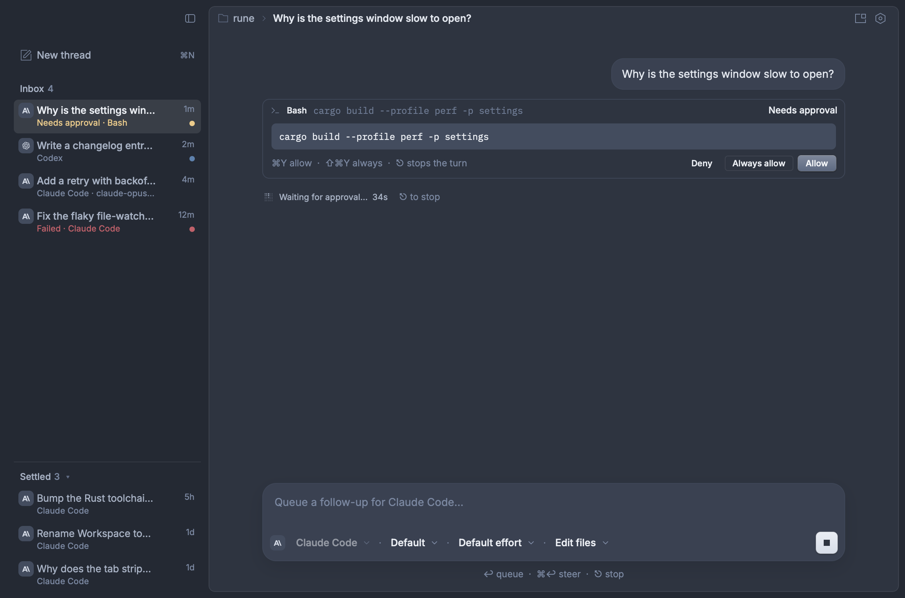
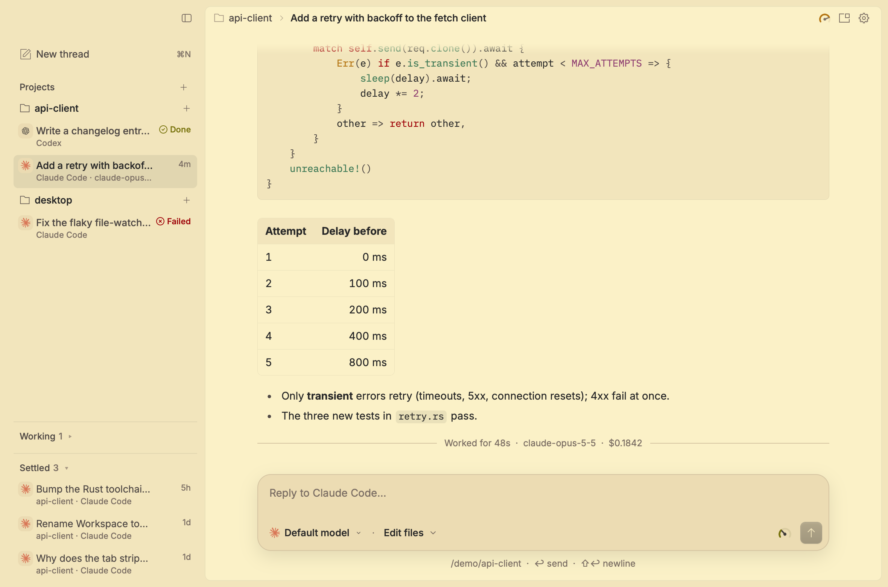

# Rune Code

A small T3 Code-style desktop app for prompting coding agents, built to try out
[Rune](https://github.com/anomalyco/rune), a GPU-rendered Rust UI framework, and see how it feels and how fast it is.
It's a prototype, not a full T3 Code.



Usage: the Claude plan's limits and what Claude Code has spent (⇧⌘U):



Nord dark and Gruvbox light:




## Run

```sh
cargo run --release                 # opens on the project used last
cargo run --release -- ~/code/app   # or adds and opens a project folder
```

The sidebar lists every project, as T3 Code does, each with its threads under its name. **⌘O** (or the + beside Projects) adds a project, the + on a project starts a thread in it, and the × under the pointer takes it out of the sidebar (its folder and saved sessions stay). On the first launch, the folders Claude Code has sessions in become the projects, temporary folders aside. Where the app is started from doesn't matter: it opens the project used last.

## Package

```sh
cargo install cargo-packager --locked   # once
cargo packager --release                # target/release/Rune Code.app and Rune Code_<version>_<arch>.dmg
```

On Windows the same command builds an NSIS installer and on Linux a `.deb` and an `.AppImage` (untested so far). The config is `[package.metadata.packager]` in `Cargo.toml`. The macOS bundle is ad-hoc signed, with no Apple account: copied from the `.dmg` after a browser download, it needs right-click › Open the first time. The icon's source is `assets/icon.svg`; `scripts/icons.sh` renders the `.icns`, `.png` and `.ico` from it.

- **Return** sends and **Shift-Return** adds a newline (or, with Settings › Chat › Send with set to ⌘ Return, **⌘Return** sends and Return adds a newline). **Esc** stops a running turn, killing the CLI's whole process group so a tool command it started can't keep the turn alive.
- **While a turn runs**, Return **queues** the message: queued messages sit above the prompt and go in order when the turn ends. **⌘Return** (or the ↗ button on a queued message) **steers**: it stops the turn and sends the message straight away on the same session. After Esc the queue waits until you send from it. Settings › Chat › Follow-ups can make sending steer instead; the Steer key (⌘Return, or ⇧⌘Return when ⌘Return sends) then queues.
- **⌘N** starts a new thread, **⌘O** adds a project, **⇧⌘U** shows usage and plan limits, **⇧⌘B** shows or hides the sidebar, **⇧⌘P** shows frame stats, and **⌘,** opens Settings. Settings takes over the main pane, with its pages down the left as in T3 Code; Esc, Done or picking a thread closes it. The pages:
  - **Appearance**: theme, and light, dark or the system's.
  - **New threads**: what a new thread starts with: the agent (CLI), the access level, and each agent's model and reasoning effort. ⌘N and the first screen at launch start from these; switching agent on the new-thread screen takes that agent's; the composer can still change them before you send. Reset goes back to the CLIs' own defaults.
  - **Chat**: Send with (Return, or ⌘ Return for long prompts) and Follow-ups (queue or steer while a turn runs).
  - **Agents**: which CLIs were found, and how many models each reported. Look again searches once more (after installing one, say). **Messages from your other sessions** (on by default) lets your other Claude Code sessions, here or in a terminal, message a Claude Code thread here (`SendMessage`), for example to say which files they're editing. Each turn passes `--settings '{"crossSessionInbound":"accept"}'`, or `"refuse"` with the switch off. Without either, the CLI holds a message from a session in a different permission mode for an approval a thread here can't give, so the message would expire unread. A message can't give a thread more access than it has.
  - **Keyboard shortcuts** (below).
  - **Advanced**: frame stats, the settings file (Show in Finder), and the version.
- **Every shortcut can be changed** in Settings › Keyboard shortcuts. Click one and press the new keys: Esc cancels, ⌫ clears, and a chord that's already in use is refused. The list covers new thread, sidebar, settings, frame stats, focus prompt, previous/next thread (⌥⌘↑/↓), settle thread (⇧⌘S), delete thread (⇧⌘⌫), stop, steer, and opening the pickers (⇧⌘M for the model picker, which ⇧⌘H and ⇧⌘E also open; ⇧⌘A for access). Changes save to `~/Library/Application Support/dev.rune-code/prefs.json`, along with the appearance. The menu bar's Settings… item picks up a new chord at the next launch.
- The window answers macOS tiling (Window › Fill, Center, Move & Resize, and their Fn-Control shortcuts).
- The composer has two pickers:
  - **the model picker** (⇧⌘M, after T3 Code's): one chip ("Opus 5.5 High") opening a popover with Favorites and each harness down a rail, a search over the harness's models, and the reasoning effort beside them.
    - The **harness** is fixed once a thread starts, since sessions don't move between CLIs; a harness that isn't installed is dimmed.
    - **Models** are asked of the CLI at launch (see below). The first five show until you search or press Show more. ⌘1–⌘9 pick a row by number, ↑↓ and Return pick too, and Esc closes.
    - The **star** on a row pins the model to Favorites, which are saved in prefs.
    - **Effort** is Claude Code `--effort` (low … max) and Codex `model_reasoning_effort`. Its column is hidden for harnesses with no effort flag. Default sends no flag, so the CLI picks.
  - **access**: Read only, Ask first, Edit files or Full access. With Claude Code, anything beyond the level you pick asks you in the app (see Approvals) instead of being refused:
    - **Ask first** lets reads through and asks before edits and commands;
    - **Edit files** lets edits through and asks before commands;
    - **Full access** never asks;
    - **Read only** refuses without asking.

    Changing the access picker while a Claude Code turn runs applies to that turn straight away (the Agent SDK's `set_permission_mode` control request; turns start with `--allow-dangerously-skip-permissions` so Full access can be switched on mid-turn), and approvals the new level covers are allowed. Read only can't be switched on mid-turn.

    The other CLIs can't ask in their one-shot modes, so for them this choice is made up front. Ask first isn't offered for them.

## Usage and plan limits

The gauge in the toolbar (**⇧⌘U**), or the one in the composer while Claude Code is the harness, shows how close the Claude plan is to its limits and what Claude Code has spent, as T3 Code's usage page does.

- **Plan limits.** Each window the plan has (the 5-hour session, the week, a model's own weekly allowance such as Fable's) gets a meter: how much is used, when it resets, and a tick where even spending would be by now. "Ahead of pace" means you're spending faster than the window passes. Past 75% a meter turns amber ("Near limit"), and past 90% red. The composer's gauge shows the tightest window, and clicking it opens every meter in a popover.
  - The numbers come from the CLI's `get_usage` control request (what the Agent SDK's usage call and `/usage` read), sent to `claude -p --input-format stream-json` with no prompt, so no tokens are spent. It answers in about half a second.
  - They're read at launch, after every Claude Code turn, and every 5 minutes. During a turn the CLI's `rate_limit_event`s move the session and weekly meters live. The last reading is saved, so the gauge has numbers at the next launch straight away.
  - Signed in with an API key (no plan), there are no windows, and the page says so.
- **Spend at API prices.** Today, 7, 30 or 90 days: cost, tokens, the share of input read from cache, a cost-by-day chart (hover a day for its figures), and tables by model and by project.
  - It's built from Claude Code's own transcripts (`~/.claude/projects/**/*.jsonl`, or each `$CLAUDE_CONFIG_DIR`), so terminal sessions count as well as the app's. A message is counted once by `message.id` + `requestId`, because the CLI writes one line per content block and a resumed session repeats its history. Only transcripts that changed are read again: 25 transcripts took 21 ms here, and a rescan 0.6 ms.
  - Prices are LiteLLM's table (T3 Code's source too), fetched once a day with `curl`. Only its Claude rows are kept in prefs. Offline, a built-in copy (`src/usage_prices.json`) prices them. 1-hour cache writes, fast mode, US-only inference and the long-context tiers each get their own rate. Checked against the CLI: a Haiku turn it billed at $0.00207222 prices to exactly that.
  - On a subscription this is what the same tokens would cost on the API, a measure of use rather than a bill.

## Uninstall

Rune Code keeps one small file of its own, `prefs.json` (shortcuts, appearance, theme, new-thread defaults, the send and follow-up settings, the projects and the last one used, settled threads, the model lists, favorite models, the last plan-limits reading and Claude's prices), in `dev.rune-code` in the platform's config folder. Pasted screenshots wait in the temp folder's `rune-code-pastes` and are deleted a day later, at the next launch. On macOS, the system also keeps a GPU shader cache for the app.

| Installed with | Remove the app | Remove its data |
| --- | --- | --- |
| `.dmg` (macOS) | Drag Rune Code from Applications to the Trash | `rm -rf ~/Library/Application\ Support/dev.rune-code "$(getconf DARWIN_USER_CACHE_DIR)dev.rune-code"` |
| Homebrew cask (macOS) | `brew uninstall --zap rune-code` | The cask's `zap` removes the same two folders |
| Nix | Drop it from your config (or `nix profile remove`) | As for the `.dmg` on macOS; `rm -rf ~/.config/dev.rune-code` on Linux |
| `.deb` / `.AppImage` (Linux) | `sudo apt remove rune-code`, or delete the `.AppImage` | `rm -rf ~/.config/dev.rune-code` |
| Installer (Windows) | Settings › Apps › Rune Code › Uninstall | Tick "Delete the application data" in the uninstaller |

Uninstalling leaves the agents' own files alone, since the terminal CLIs share them: Claude Code's session transcripts (`~/.claude/projects/`), and "Always allow" rules saved to a project's `.claude/settings.local.json`.

## Approvals

When Claude Code wants to run a tool your access level doesn't allow, the tool's row shows the full command or path, with **Deny**, **Always allow** and **Allow**. The turn waits until you answer, and the sidebar marks the thread "Needs approval".

- **⌘Y** allows and **⇧⌘Y** always allows. Esc stops the whole turn.
- **Always allow** saves the rule Claude Code suggests (for example `Bash(cargo check:*)`) to the project's `.claude/settings.local.json`. That rule then applies to every later session, including ones run from the terminal.

This works the way the Claude Agent SDK talks to the CLI. The prompt goes in on stdin (`--input-format stream-json`), and `--permission-prompt-tool stdio` makes the CLI send a `can_use_tool` control request and wait for the app's `control_response`. stdin is closed after the turn's result so the CLI exits, so each turn is still one process.

## What's there

- The sidebar is an inbox, after T3 Code's:
  - At the top, with no heading: threads that need you, the last to come back first. A label in each card's corner says why: **Approval** (a tool waits for you), **Failed** or **Done** (a turn ended since you last looked). A card with nothing for you shows how long ago it was active instead, and fades back.
  - **Working**, a shelf at the sidebar's foot, shut by default: threads with a turn running and nothing asked of you, each with how long it has run and a spinner. Shut, it still shows the thread you're reading.
  - **Settled**, below it: threads you're done with. **⇧⌘S** settles the open thread and goes on to the next one in the inbox, so you can work down to "All caught up". Hovering a row shows ✓ (settle) or ↩ (back to the inbox) and × (delete). A settled thread comes back to the inbox as soon as it does anything: a message sent, an approval asked, or a turn finished. Threads untouched for 7 days settle on their own (T3 Code's default): checked at most once a minute while the app is in use, and otherwise only when the next one is due, so an idle window doesn't wake for it. Running, asking or queued threads, and ones you moved back to the inbox by hand, never auto-settle. The shelf is shut by default, scrolls on its own once it's 320 points tall, lists 30 at a time, and still shows the thread you're reading when shut. What you settle is saved by session id in prefs, so it holds across launches. **× (or ⇧⌘⌫) deletes** after asking (Return deletes, Esc keeps it): the thread goes, and for a Claude Code thread so do its session's files, so it doesn't come back next launch. That means the transcript (`~/.claude/projects/<folder>/<id>.jsonl`), the folder beside it (subagent and tool output), and `file-history/<id>` and `session-env/<id>` (in `$CLAUDE_CONFIG_DIR` when that's set). It's gone from `claude --resume` too. The project's `memory/` folder isn't touched. Codex and OpenCode threads only leave the app.
  - While the window isn't focused, a thread that finishes, fails or asks for approval posts a system notification (clicking it opens the thread) and counts on the Dock icon's badge, which clears when you come back. Notifications need the bundled app (`cargo packager --release`); `cargo run` gets the badge only. Linux gets neither yet.
  - With the sidebar hidden, a badge on the sidebar button's corner says something wants you: amber for an approval, red for a failure, the accent colour for a finished turn.
- The toolbar starts with a "project › thread title" breadcrumb, as T3 Code's header does.
- Claude Code threads carry Claude's spark in its terracotta, the mark T3 Code uses (from its MIT-licensed `Icons.tsx`), instead of the OpenCode icon set's Anthropic "A".
- **Themes**: OpenCode, Nord and Gruvbox, each in light and dark (Settings › Appearance › Theme; Mode picks light, dark or the system's). Nord and Gruvbox keep the OpenCode kit's fonts, spacing and shadows and recolour it: every grey in OpenCode's palette maps by its lightness onto the theme's own ramp, and the accent, status and code colours come from the theme (`src/ui/theme.rs`).
- Settings › Agents counts the models each installed CLI reported. "Default" (let the CLI choose) isn't counted, and a CLI that isn't installed shows none.
- The sidebar also lists each project's saved Claude Code sessions (`~/.claude/projects/<folder>/*.jsonl`), from the terminal or earlier runs, titled as Claude Code titles them; opening one reads its transcript, and replying resumes it.
- Drop images (PNG, JPEG, GIF, WebP) anywhere on the window, or paste a screenshot into the prompt, to attach them. Claude Code gets them as image blocks; Codex as `--image`; OpenCode gets the paths in the prompt.
- A transcript that streams Markdown as it arrives: code fences are syntax-coloured and tables, lists and inline code render. Text is selectable.
- Tool calls appear as rows: icon, tool name, a one-line summary and a running/ok/failed status. Click a row to see its output.
- A "Worked for 48s · model · $cost" line after each turn.
- Follow-up messages resume the same CLI session (`--resume`).

## Harnesses

| Harness | Command | Status |
| --- | --- | --- |
| Claude Code | `claude -p --input-format stream-json --output-format stream-json --include-partial-messages --permission-prompt-tool stdio …` | Tested live: streaming, resume, tool calls, stop. Approvals tested against a stand-in CLI; live test written (`live_claude_asks…`) |
| Codex | `codex exec --json …` | Parser written to the JSONL format; untested (not installed here) |
| OpenCode | `opencode run --format json …` | Parser written to the JSON event format; untested |

Harnesses not found on `PATH` (or in `~/.local/bin`, Homebrew and similar locations) are listed under "Not installed".
Each one is a `command` plus a `parse` function in `src/harness/`.

Model lists come from the CLIs themselves (`src/harness/models.rs`). For Claude Code, the app sends the Agent SDK's `initialize` control request (the one behind `supportedModels()`) to `claude -p --input-format stream-json` and reads back the models your account has. New models such as Fable appear without an app change, and no tokens are spent. OpenCode's list comes from `opencode models`. Codex can't list its models, so it keeps a short built-in list. The last answer is saved, so the list is right on the next launch before the CLI replies. If asking fails, the built-in list stays.

Steering stops the turn and resumes the session with the new message, because print mode (`-p`) can't take input once a turn has started. Claude Code's streaming input mode might accept a message mid-turn without the restart. That's untested, so it isn't used yet.

## Layout

```
src/main.rs            app spec, poll, scenes, live tests
src/bench.rs           perf benches (CPU, allocations and heap per frame)
src/app.rs             state: threads, items, the queue, applying harness events
src/shortcuts.rs       the shortcut table: commands, defaults, overrides, recording
src/harness/           spawning CLIs and parsing their JSON lines
src/harness/models.rs  asking each CLI for its models
src/harness/limits.rs  Claude's plan limits (`get_usage`, `rate_limit_event`)
src/usage.rs           spend from Claude Code's transcripts, priced from LiteLLM's table
src/history.rs         Claude Code's saved sessions for the project
src/ui/mod.rs          window: SplitView shell, toolbar, new-thread hero
src/ui/sidebar.rs      thread list: inbox, Working and Settled shelves
src/attention.rs       notifications, Dock badge, auto-settle sweep
src/ui/theme.rs        OpenCode, Nord and Gruvbox kits
src/ui/transcript.rs   virtualised, memoised transcript
src/ui/composer.rs     prompt field and pickers
src/picker.rs          the model picker's state: rail, search, favorites, keys
src/ui/picker.rs       the model picker's chip and popover
src/ui/usage.rs        the Usage page, the composer's gauge and its popover
src/ui/hud.rs          frame stats (⇧⌘P)
```

## Checking it without a window

Rune runs any app headless, using the same renderer:

```sh
cargo build
target/debug/rune-code --snap out.png --scene demo --size 1180x780 --theme light   # scenes: demo long empty picker effort settings usage usage-popover queue approval attach collapsed
cargo test                                                    # parsers, shortcuts, queue/steer and approvals (against a stand-in claude)
cargo test -- --ignored live_claude --nocapture               # drives the real `claude` through the UI (costs a few tokens)
cargo test -- --ignored live_usage --nocapture                # reads the real plan limits and transcripts (no tokens)
cargo test --profile perf -- --ignored bench --nocapture --test-threads=1   # perf numbers
```

## Performance (Apple silicon, `--profile perf`, headless at 2×)

The benches in `src/bench.rs` time each frame's CPU work: update, view, layout and paint. They don't cover GPU encode, presentation, or the window's drawables (about 42 MB at 1180×780). A counting allocator, used only in test builds, reports allocations and bytes per frame, along with heap growth. The frame-stats panel (⇧⌘P) shows the same frame times live.

| | p50 | p95 | max | allocs/frame |
| --- | --- | --- | --- | --- |
| Open a 3,000-row thread (Markdown, code, tables, tool rows) | 4.7 ms (one frame) | | | 45k |
| A frame that streams one text delta into it | 0.70 ms | 0.80 ms | 1.35 ms | 10k |
| A wheel-scroll frame through the history | 0.14 ms | 0.38 ms | 0.58 ms | 1 |
| An idle frame | 0.13 ms | | | 0 |
| A delta into a 0–8 KB answer | 0.57 ms | 0.78 ms | 1.45 ms | 2.9k |
| A delta into a 56–64 KB answer | 2.95 ms | 3.25 ms | 3.66 ms | 16k |
| 16 threads streaming at once, one on screen | 1.10 ms | 1.54 ms | 2.02 ms | 6.8k |

- Per-delta cost grows with the length of the streaming message. Rune's Markdown parses only the last block again, but each frame still rebuilds and lays out every block, so cost grows linearly. A 64 KB answer still fits a 120 Hz frame; a 250 KB one wouldn't.
- Thread state costs about 280 bytes per row. Tool output is kept whole, though a card shows only its first 40 lines, so a 1 MB `cargo test` log keeps about 1 MB alive.

Profiling the live app, or a bench, with function names (the `perf` profile keeps line tables):

```sh
cargo build --profile perf
samply record ./target/perf/rune-code                    # macOS and Linux; `cargo install samply`
xcrun xctrace record --template 'Time Profiler' --launch -- ./target/perf/rune-code   # macOS
perf record -g ./target/perf/rune-code                   # Linux; `perf stat` for cache misses and IPC
footprint $(pgrep -n rune-code)                          # macOS memory by kind
top -pid $(pgrep -n rune-code) -stats cpu,mem,idlew,power   # idle wakeups and energy
```

Live with Claude Code (haiku), the first streamed text lands about 1.5 s after Return; that time is the CLI, not the UI.
The release build's native window was ready 663 ms after the process started.
At rest the window draws nothing: `poll` asks for a redraw only when an event lands, and once a second for the "Working…" counter.

What makes it fast is mostly Rune's own machinery:

- `virtual_rows` builds only the rows near the viewport.
- `memo` keeps each finished message's subtree, so a streaming delta rebuilds only the message that is growing.
- Scrolling never re-runs the view.

## Notes on Rune from building this

- The `rune-kit` shell (`SplitView`, `Sidebar`, `Toolbar`), `Markdown` and `Select` gave a polished T3/OpenCode look with very little code. The opencode theme crate brings the fonts, icons and tokens.
- The headless `--snap` and `Runtime` test harness made it possible to check layout and real agent turns without opening a window.
- `rune::Keybind` and `rune::Chord` cover the whole shortcut table: parsing "mod+shift+b", matching key events (with the user's layout), and labels such as "⇧⌘B". `rune::prefs::Prefs` saves the table. rune-kit's `ShortcutRecorder` is built for global hotkeys, so in-app rebinding uses a small recorder of its own that asks `Chord::matches` which chord a key press is.
- Gotchas hit:
  - A focused text field swallows Escape before the window's `on_key`, so Stop goes through the field's `on_input_key`.
  - `Select` menus size to their 160 pt minimum and truncate longer option labels.
  - A `memo` replaces its root's key.
  - The Window menu isn't registered as `NSApp.windowsMenu`, so macOS adds no tiling items and Fn-Control-arrows did nothing. Custom app-menu items also go above About. `src/ui/mac.rs` fixes both. They are worth fixing upstream.
  - A headless `Runtime` doesn't take the spec's `on_key`; tests set `rt.on_key` themselves.
  - `Toolbar`'s band is a fixed 48 points (`TOOLBAR_HEIGHT`). With `SplitView::toolbar_in_panel` and an 8-point frame inset it centres 32 points down, and SplitView's sidebar toggle with it, about 8 points lower than other macOS apps put the traffic lights. Moving the toolbar out of the card fixes the line but puts a bar over the card. So the toolbar stays in the card, its contents are lifted 8 points (`El::offset`), and the app draws its own sidebar toggle on the lights' line (`ui::sidebar_toggle`), with SplitView's hidden. A settable band height, or a toolbar offset, upstream would remove both workarounds.
  - Kit colours are linear: `Color` stores linear sRGB, so `{:?}` of a palette doesn't show the hex you'd see. `Color::hex()` and `rune::color::hex()` convert.
  - `SidebarRow` centres its detail and status slot on the whole row, and `on_close` reserves the 20-point slot on every row. For mail-style rows (time on the first line, status on the second) the thread rows build their own `trailing` column and hover actions with `group_opacity`.
  - `SidebarSection::collapsed` drops every row, so the Settled shelf adds the open thread's row itself when it's shut.
  - A row that is still springing to a new place doesn't take the hover yet. In tests, let the motion finish before hovering.
  - A `Popover` settles beside its trigger over the frames after it opens. A test that presses something inside it on the very next frame hits the scrim (and closes it), though `element_at` already reports the button.
  - There's no `flex-basis`. Equal-width tiles and chart columns are `.w(0.0).grow(1.0)`.
  - An `Icon`'s view is square, so a non-square SVG (Claude's spark is 256 × 257) takes the larger side. A monochrome icon tinted with `.color()` keeps a brand colour without Rune's `svg` feature.
  - `--snap` runs `setup`, so background reads it starts could land in a snapshot. The usage scenes hold them off by putting channels with no sender where the running reads' channels go.
